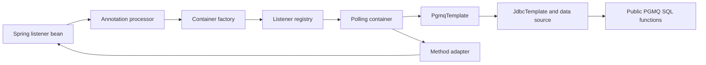

# Architecture and maintenance boundaries

## Runtime path

`PgmqTemplate` is the public SQL facade. It owns parameter binding, JSON handling and row mapping.
Public SQL functions stay the database boundary; underscore-prefixed functions remain upstream
implementation details. Queue, topic and notification wrappers share this facade rather than
introducing separate operation interfaces for each SQL family.

The annotation processor discovers methods, records their identity, and registers initial or later
lazy singleton beans. The factory resolves annotation/property defaults and creates adapters and
containers. The registry coordinates container lifecycles and publishes a dynamic registration only
after successful startup. These roles remain separate because discovery, configuration and resource
ownership change independently.

## Validation ownership

| Boundary | Responsibility |
| --- | --- |
| `PgmqProperties` setters | Reject invalid values at the public mutable configuration/binding entry point. |
| Factory | Resolve `-1`, enum defaults and Spring string expressions; no duplicate numeric range checks. |
| `PgmqListenerContainerOptions` | Enforce the resolved immutable runtime invariants, including cross-field capacity limits. |
| Method adapter | Require synchronous `void` methods and reject `@Async`; resolve invocation arguments. |
| Template | Validate supplied operation arguments once on the execution path; delegate SQL defaults and database-specific rules. |
| PostgreSQL | Enforce queue naming, extension availability and SQL operation semantics. |

Property setters and runtime options are separately callable public boundaries. Their checks are
retained; the intermediate factory does not repeat the runtime numeric rules. Zero-duration reads
and shared-header batch overloads delegate to the common validated path.

Spring supplies embedded string resolution, Boolean conversion and worker thread factories. Java
supplies executors, bounded queues, semaphores, immutable records and transaction-safe JDBC resource
management through Spring. No custom expression parser or additional scheduling framework is used.

## Execution and resource lifetime

Each container start creates one run state containing its active flag, executors and permits.
Tasks retain that run state. A late task can finish work after a forced stop, but cannot release
capacity or dispatch messages into a newer run.

Pollers reserve capacity before reading. Successful reads release unused permits before dispatch.
Consumers release permits in `finally`, including error paths. The poller quota uses an overflow-safe
integer ceiling calculation. The default consumer executor is bounded; custom executors must enforce
their desired execution concurrency and belong to one container.

Stopping interrupts pollers, waits for them, then drains consumers. The configured timeout applies
to each executor phase. JDBC query/network deadlines remain distinct from thread interruption and
from PGMQ's visibility/polling deadlines.

## Payload conversion and acknowledgement

The template restores known compatible `_type` hints. Missing or unusable hints leave generic JSON
values; the adapter converts each message to the listener's declared parameter type. This keeps a
bad type hint or a typed-argument conversion failure from hiding healthy messages in the same batch.
Headers remain available to the error handler together with the message ID.

The default adapter is synchronous. Supporting arbitrary futures, reactive publishers or application
async dispatch would require a different completion/backpressure contract, so the default adapter
rejects those declaration forms instead of silently acknowledging early.

Acknowledgement handles serialize completion attempts and publish completion only after the SQL
call returns. Business idempotency, redelivery limits and dead-letter routing stay application
policies. Transaction commit and exactly-once side effects are not inferred from the local handle.

## Metrics

A private per-registry binding owns Micrometer `MeterProvider` instances. Each recorded event shares
one immutable `Tags` value between its counter and timer. Micrometer owns meter lookup and caching;
there is no second application meter cache. Retry registration replaces state gauges for the same
listener/queue while retaining execution counters.

The measured allocation change is documented in [verification evidence](experiments/listener-ablation.md).
It is a component result, not a queue throughput benchmark.

## Dependencies and test infrastructure

Production dependencies are limited to the Boot JDBC starter, Jackson databind, Micrometer, optional
JSpecify annotations and the PostgreSQL runtime driver. Spring's configuration processor is supplied
only through the compiler annotation-processor path; a regression test checks generated metadata.
The JDBC driver is loaded dynamically and is not removable merely because a bytecode analyzer does
not find a direct import.

All database tests receive one explicit JDBC configuration. Testcontainers dependencies, the old
container base class and the separate Podman workflow have been removed. CI owns a pinned pg_partman
PostgreSQL service and requires partition availability. Local tests can use an ordinary disposable
PostgreSQL server and report a single partition skip if pg_partman is absent.

## Change discipline

Keep public API names aligned with public SQL entry points. Use overloads for supplied argument
combinations and keep implementation reuse private. Preserve documented extension points even if
only applications consume them. Do not delete public annotations, endpoint metadata or executor
factory interfaces based solely on the absence of internal call sites.

Use Java 17-compatible code, four-space indentation, UTF-8 and LF; Windows command files retain
CRLF. `.editorconfig` and `.gitattributes` define these rules. Run tests, coverage checks, Javadoc,
artifact checks and `git diff --check` before publishing changes. Add abstractions or hot-path
optimizations only when a concrete change scenario or measurement justifies them.
